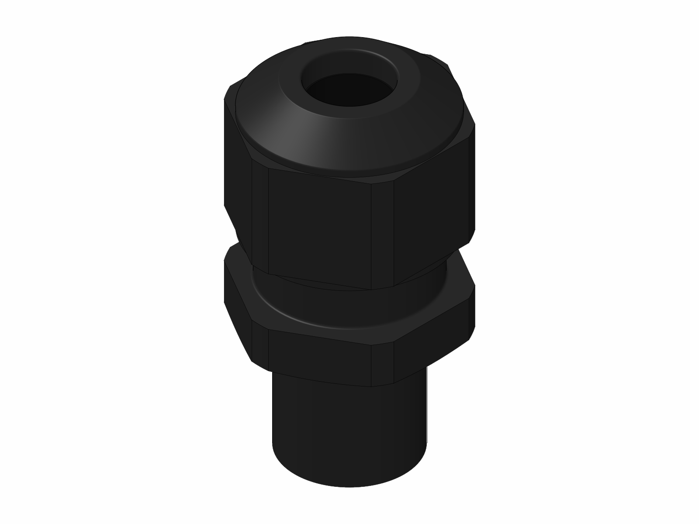
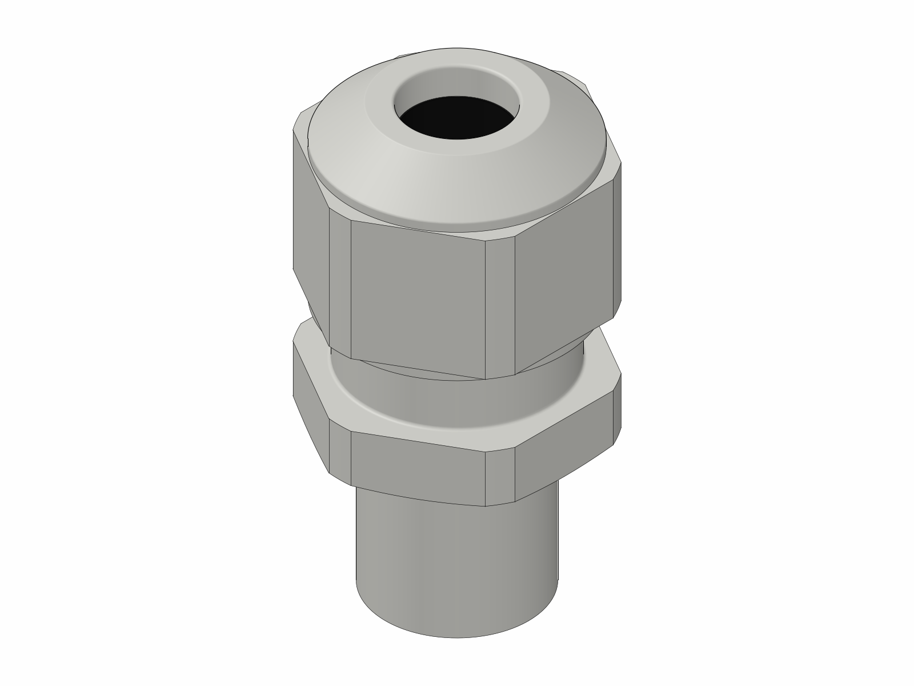

## AG10-6B

## AG10-6S

## STEP files

| Model | Color | File |
|---|---|---|
| AG10-6B | Black | [AG10-6B.step](AG10-6B.step) |
| AG10-6S | Light gray | [AG10-6S.step](AG10-6S.step) |

## Dimensions

| mm | L (Z) | D (Y) |
|---|---|---|
| Drawing | 29 | 16.5 |
| Overall (all parts) | 29 | 16.5 |

Mounting hole: M10×1.0 tapped

Notice: [NOTICE.md](../../../NOTICE.md) · License: [CC BY 4.0](../../../LICENSE)
