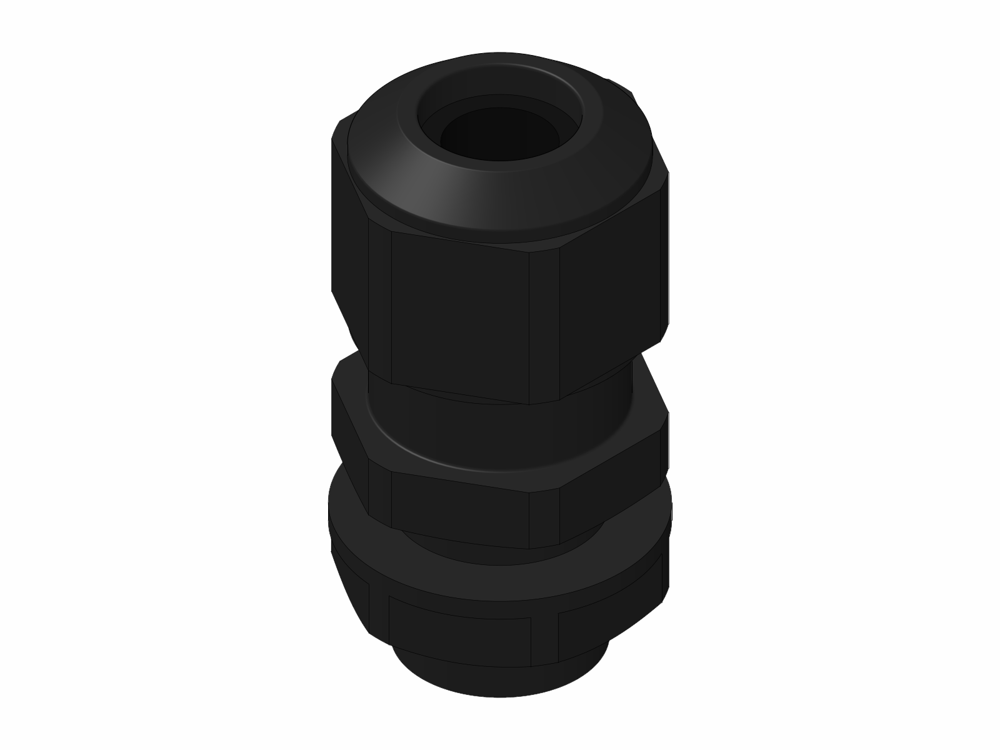
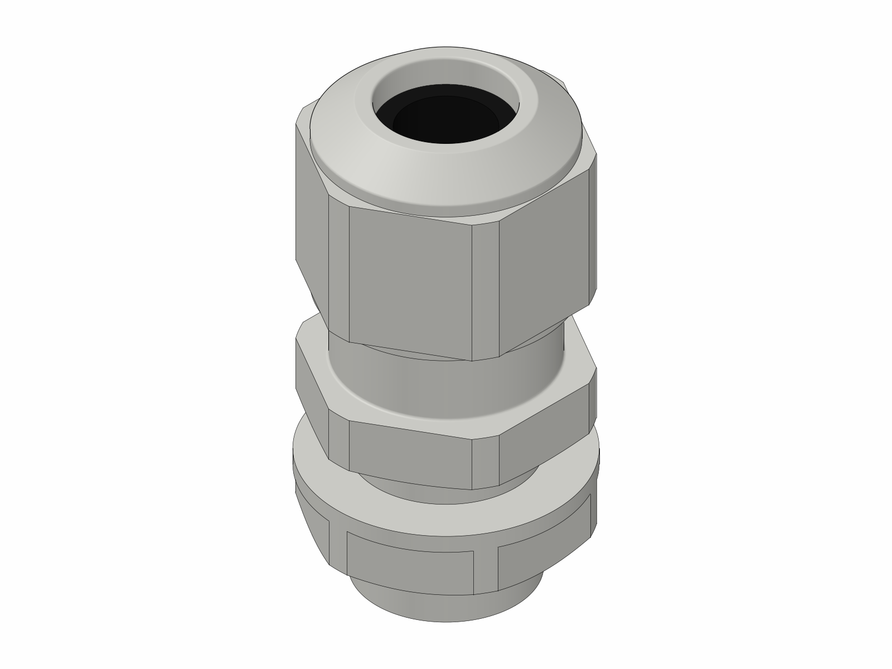

## AG12-6.5B

## AG12-6.5S

## STEP files

| Model | Color | File |
|---|---|---|
| AG12-6.5B | Black | [AG12-6.5B.step](AG12-6.5B.step) |
| AG12-6.5S | Light gray | [AG12-6.5S.step](AG12-6.5S.step) |

## Dimensions

| mm | L (Z) | D (Y) |
|---|---|---|
| Drawing | 35 | 18.8 |
| Overall (all parts) | 35 | 18.8 |

Mounting hole: ⌀12.2 mm

Notice: [NOTICE.md](../../../NOTICE.md) · License: [CC BY 4.0](../../../LICENSE)
