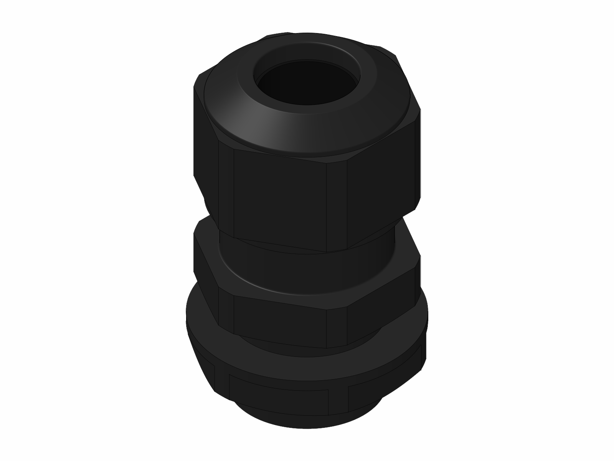
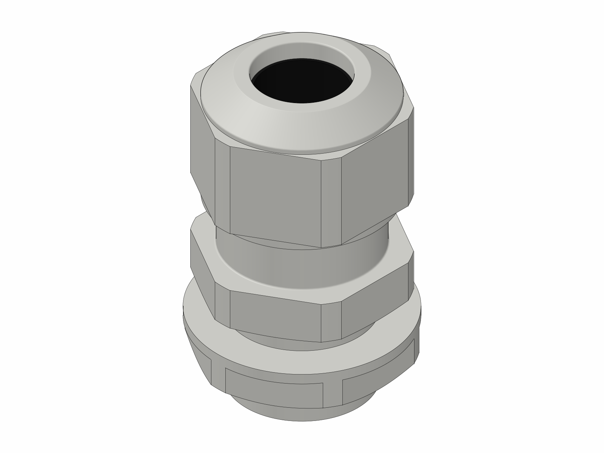

## AG16-10B

## AG16-10S

## STEP files

| Model | Color | File |
|---|---|---|
| AG16-10B | Black | [AG16-10B.step](AG16-10B.step) |
| AG16-10S | Light gray | [AG16-10S.step](AG16-10S.step) |

## Dimensions

| mm | L (Z) | D (Y) |
|---|---|---|
| Drawing | 38 | 24.3 |
| Overall (all parts) | 38 | 24.3 |

Mounting hole: ⌀16.2 mm

Notice: [NOTICE.md](../../../NOTICE.md) · License: [CC BY 4.0](../../../LICENSE)
