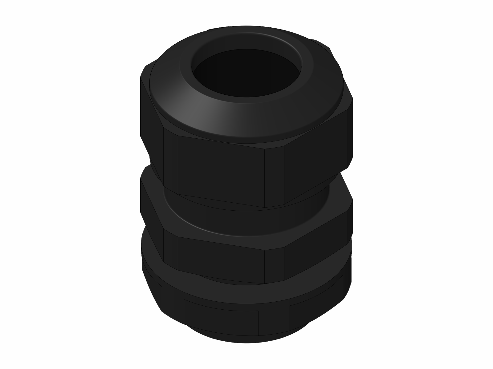
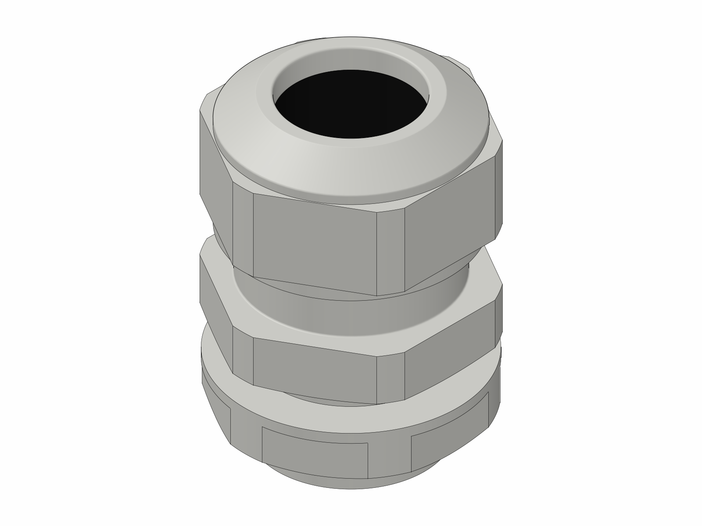

## AG20-15B

## AG20-15S

## STEP files

| Model | Color | File |
|---|---|---|
| AG20-15B | Black | [AG20-15B.step](AG20-15B.step) |
| AG20-15S | Light gray | [AG20-15S.step](AG20-15S.step) |

## Dimensions

| mm | L (Z) | D (Y) |
|---|---|---|
| Drawing | 40 | 29.7 |
| Overall (all parts) | 40 | 29.7 |

Mounting hole: ⌀20.2 mm

Notice: [NOTICE.md](../../../NOTICE.md) · License: [CC BY 4.0](../../../LICENSE)
