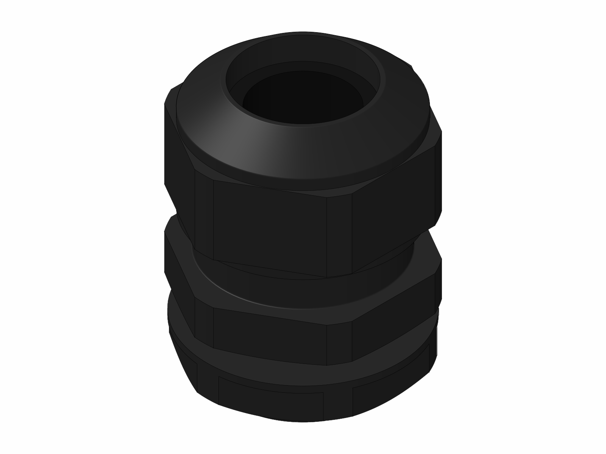
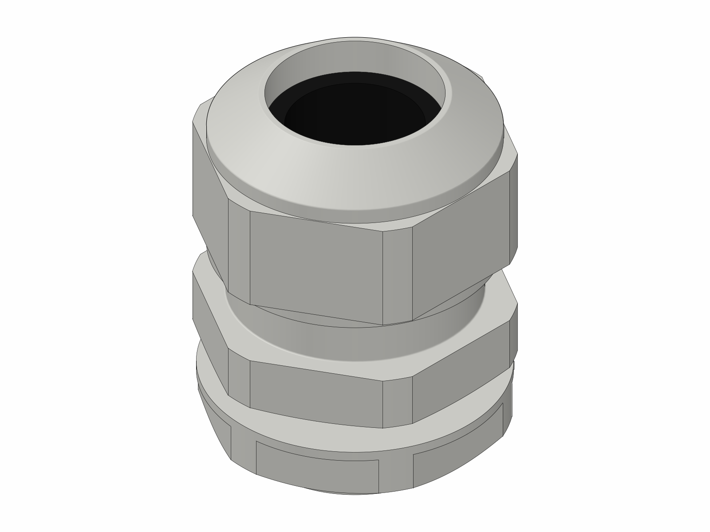

## AG25-16B

## AG25-16S

## STEP files

| Model | Color | File |
|---|---|---|
| AG25-16B | Black | [AG25-16B.step](AG25-16B.step) |
| AG25-16S | Light gray | [AG25-16S.step](AG25-16S.step) |

## Dimensions

| mm | L (Z) | D (Y) |
|---|---|---|
| Drawing | 47 | 37.4 |
| Overall (all parts) | 47 | 37.4 |

Mounting hole: ⌀25.2 mm

Notice: [NOTICE.md](../../../NOTICE.md) · License: [CC BY 4.0](../../../LICENSE)
