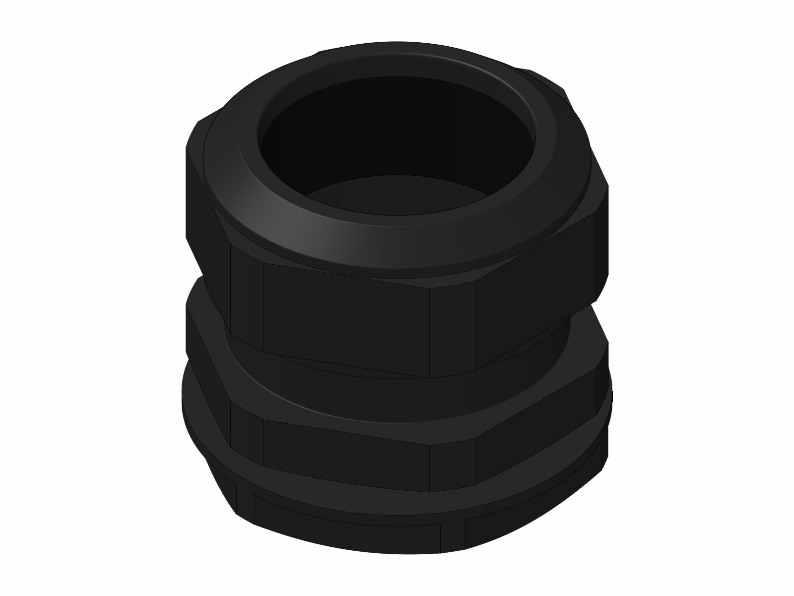
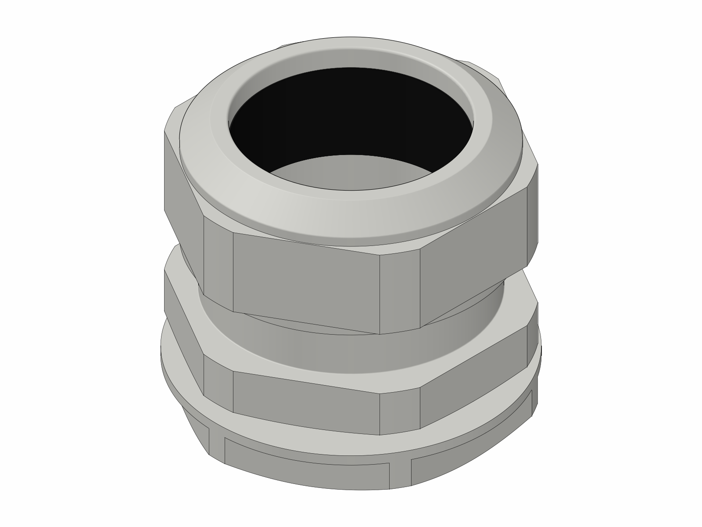

## AG50-42B

## AG50-42S

## STEP files

| Model | Color | File |
|---|---|---|
| AG50-42B | Black | [AG50-42B.step](AG50-42B.step) |
| AG50-42S | Light gray | [AG50-42S.step](AG50-42S.step) |

## Dimensions

| mm | L (Z) | D (Y) |
|---|---|---|
| Drawing | 61 | 66 |
| Overall (all parts) | 61 | 66 |

Mounting hole: ⌀50.4 mm

Notice: [NOTICE.md](../../../NOTICE.md) · License: [CC BY 4.0](../../../LICENSE)
