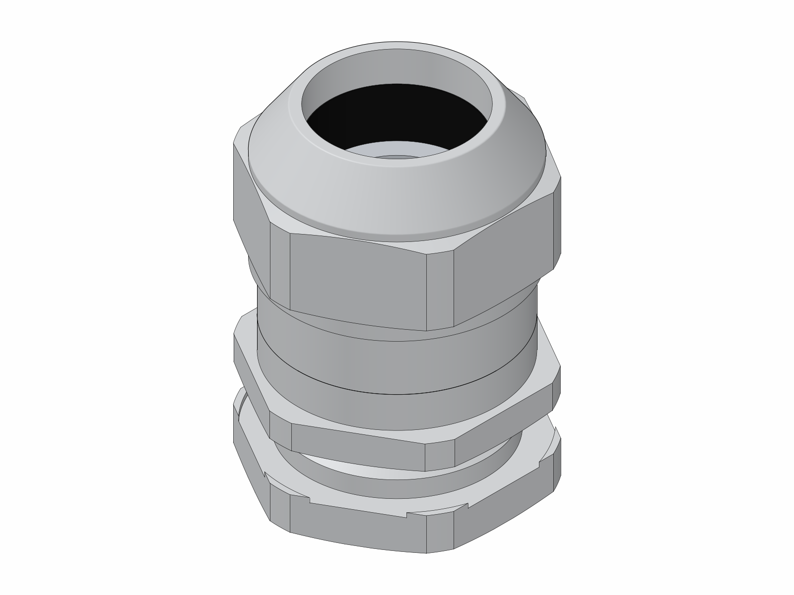

## AGE20-15

## STEP files

| Model | Color | File |
|---|---|---|
| AGE20-15 | Nickel plated | [AGE20-15.step](AGE20-15.step) |

## Dimensions

| mm | L (Z) | D (Y) |
|---|---|---|
| Drawing | 37 | 26.5 |
| Overall (all parts) | 37 | 26.5 |

Mounting hole: ⌀20.2 mm

Notice: [NOTICE.md](../../../NOTICE.md) · License: [CC BY 4.0](../../../LICENSE)
