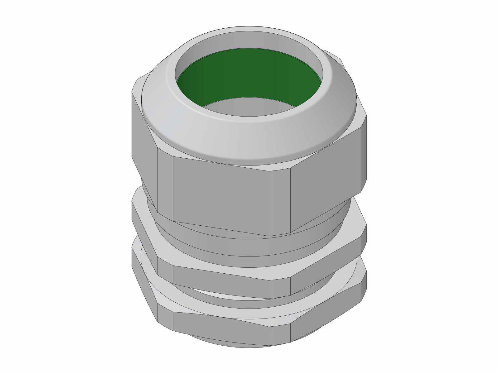

## AGH25-20

## STEP files

| Model | Color | File |
|---|---|---|
| AGH25-20 | Nickel plated | [AGH25-20.step](AGH25-20.step) |

## Dimensions

| mm | L (Z) | D (Y) |
|---|---|---|
| Drawing | 38 | 33 |
| Overall (all parts) | 38 | 33 |

Mounting hole: ⌀25.2 mm

Notice: [NOTICE.md](../../../NOTICE.md) · License: [CC BY 4.0](../../../LICENSE)
