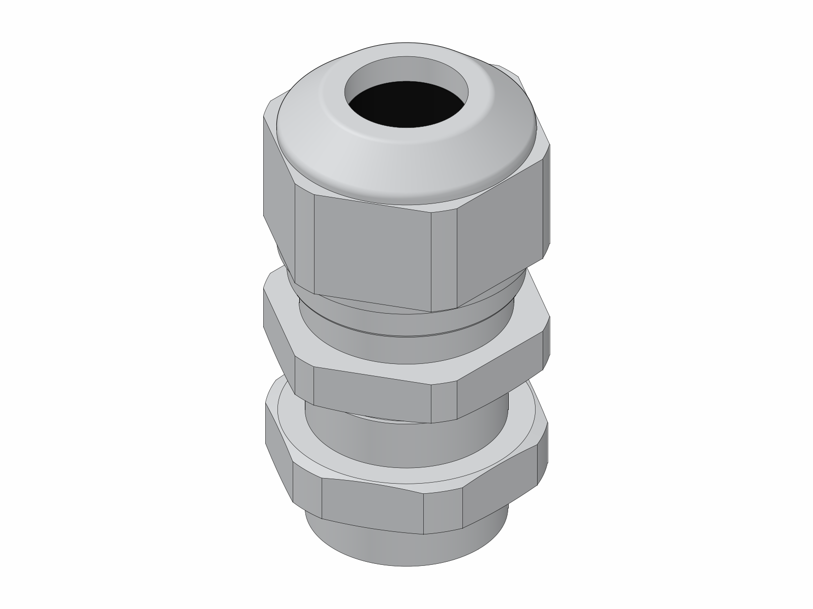

## AGM10-6

## STEP files

| Model | Color | File |
|---|---|---|
| AGM10-6 | Nickel plated | [AGM10-6.step](AGM10-6.step) |

## Dimensions

| mm | L (Z) | D (Y) |
|---|---|---|
| Drawing | 25.2 | 14.31 |
| Overall (all parts) | 25.2 | 14.31 |

Mounting hole: ⌀10.2 mm

Notice: [NOTICE.md](../../../NOTICE.md) · License: [CC BY 4.0](../../../LICENSE)
