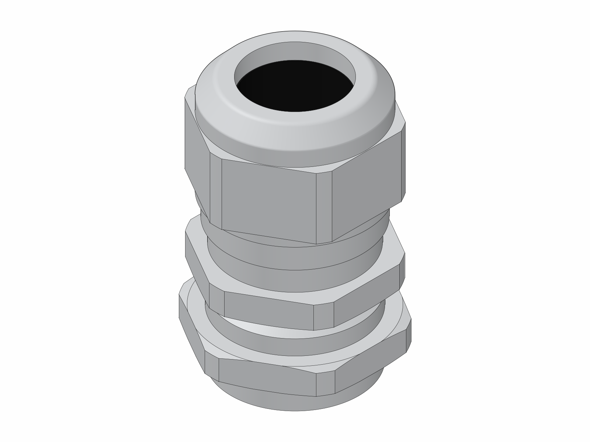

## AGM16-10.5

## STEP files

| Model | Color | File |
|---|---|---|
| AGM16-10.5 | Nickel plated | [AGM16-10.5.step](AGM16-10.5.step) |

## Dimensions

| mm | L (Z) | D (Y) |
|---|---|---|
| Drawing | 31 | 21 |
| Overall (all parts) | 31 | 21 |

Mounting hole: ⌀16.2 mm

Notice: [NOTICE.md](../../../NOTICE.md) · License: [CC BY 4.0](../../../LICENSE)
