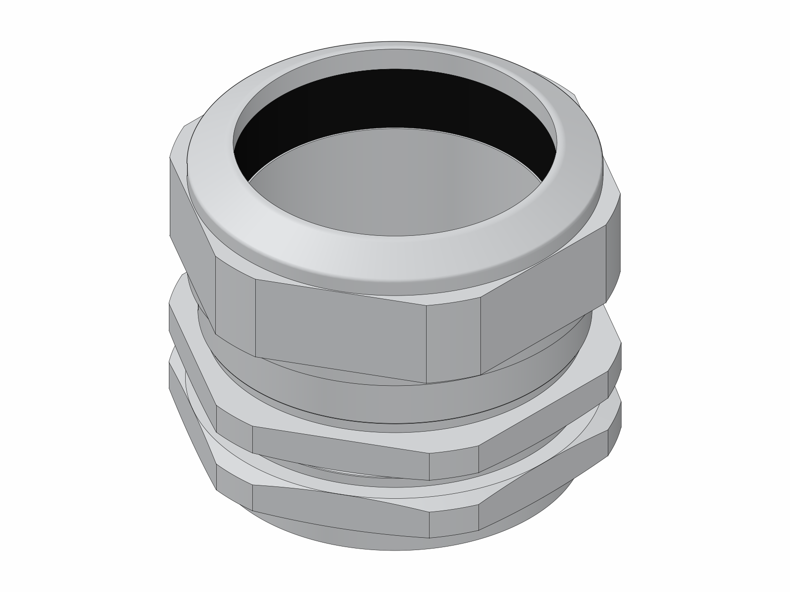

## AGM50-42

## STEP files

| Model | Color | File |
|---|---|---|
| AGM50-42 | Nickel plated | [AGM50-42.step](AGM50-42.step) |

## Dimensions

| mm | L (Z) | D (Y) |
|---|---|---|
| Drawing | 48 | 60 |
| Overall (all parts) | 48 | 60 |

Mounting hole: ⌀50.4 mm

Notice: [NOTICE.md](../../../NOTICE.md) · License: [CC BY 4.0](../../../LICENSE)
