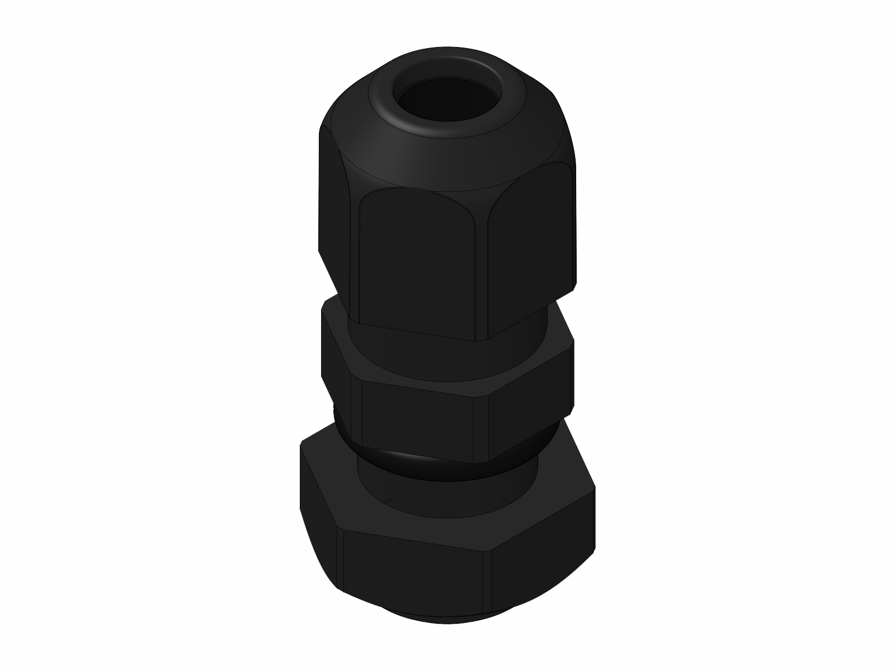
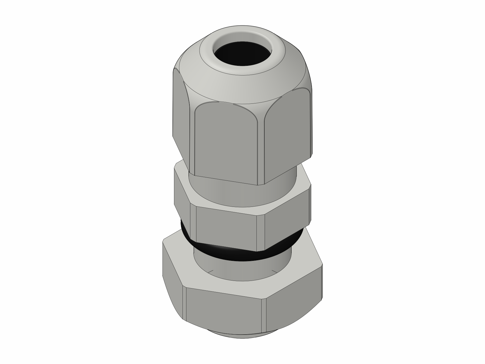

## RM10L-6B

## RM10L-6S

## STEP files

| Model | Color | File |
|---|---|---|
| RM10L-6B | Black | [RM10L-6B.step](RM10L-6B.step) |
| RM10L-6S | Light gray | [RM10L-6S.step](RM10L-6S.step) |

## Dimensions

| mm | L (Z) | D (X) |
|---|---|---|
| Drawing | 33.5 | 16.8 |
| Overall (all parts) | 33.5 | 14.8 |

Mounting hole: ⌀10.2 mm

Notice: [NOTICE.md](../../../NOTICE.md) · License: [CC BY 4.0](../../../LICENSE)
