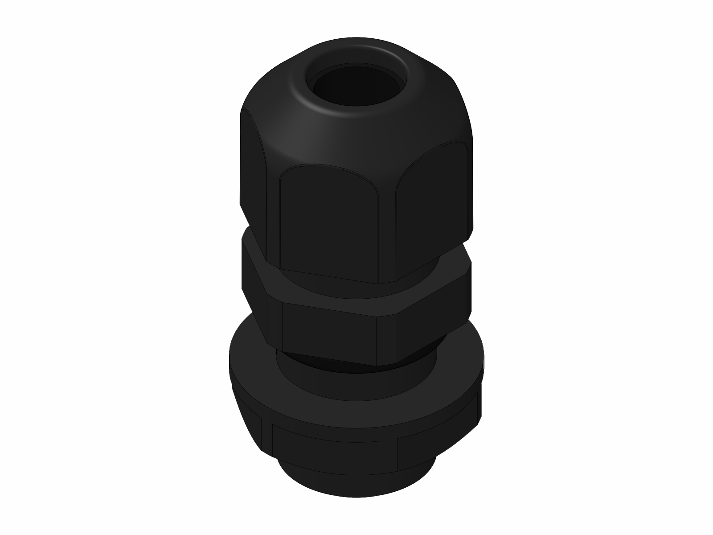
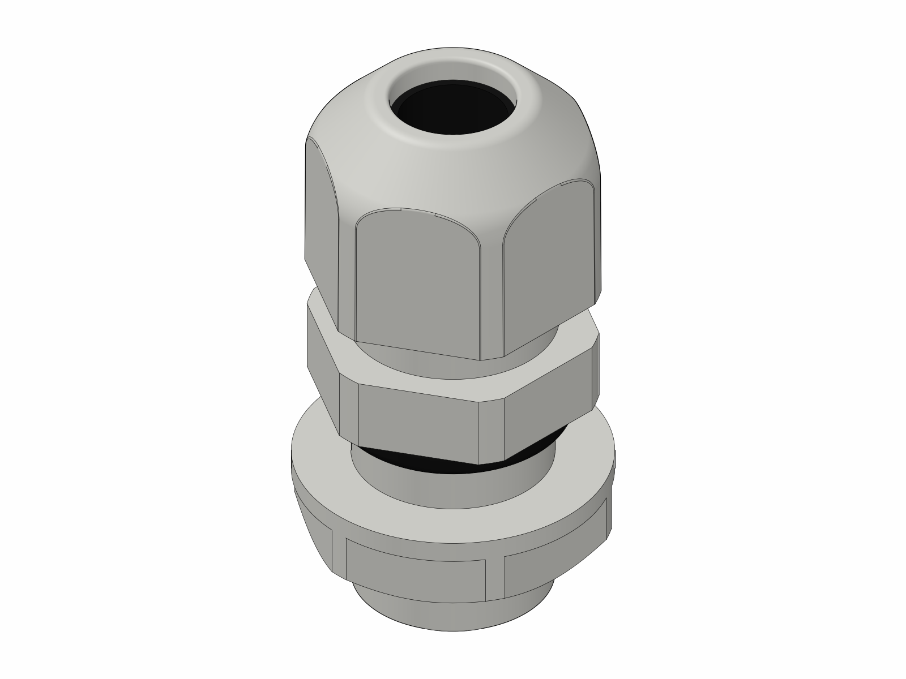

## RM12L-7B

## RM12L-7S

## STEP files

| Model | Color | File |
|---|---|---|
| RM12L-7B | Black | [RM12L-7B.step](RM12L-7B.step) |
| RM12L-7S | Light gray | [RM12L-7S.step](RM12L-7S.step) |

## Dimensions

| mm | L (Z) | D (X) |
|---|---|---|
| Drawing | 35 | 19 |
| Overall (all parts) | 35 | 19 |

Mounting hole: ⌀12.2 mm

Notice: [NOTICE.md](../../../NOTICE.md) · License: [CC BY 4.0](../../../LICENSE)
