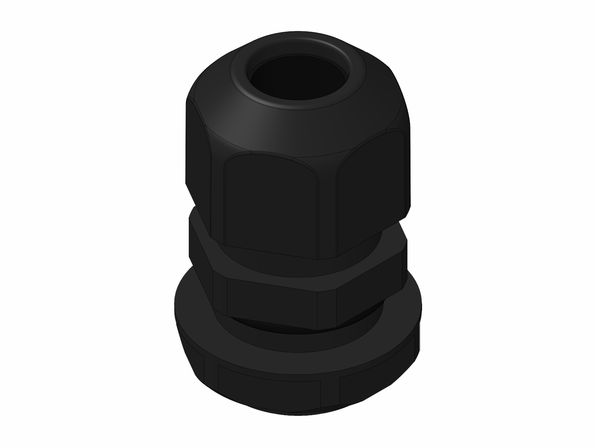
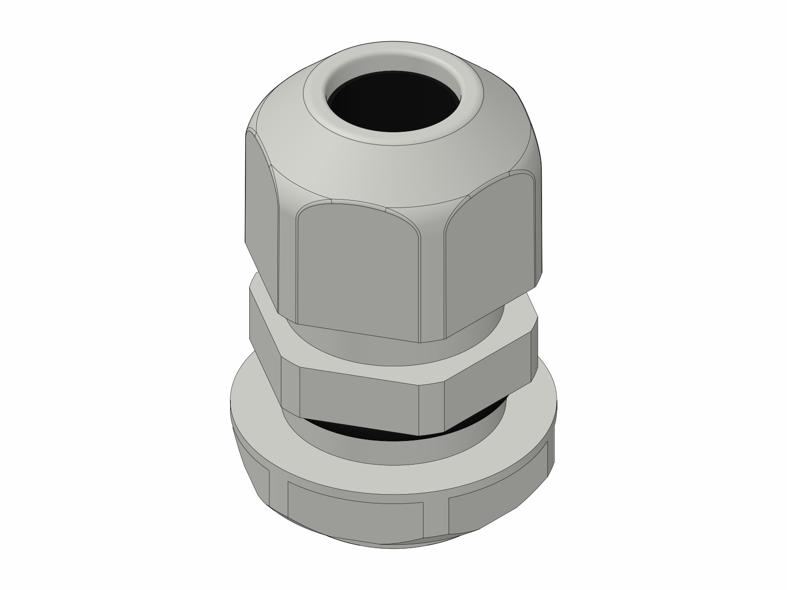

## RM20L-12B

## RM20L-12S

## STEP files

| Model | Color | File |
|---|---|---|
| RM20L-12B | Black | [RM20L-12B.step](RM20L-12B.step) |
| RM20L-12S | Light gray | [RM20L-12S.step](RM20L-12S.step) |

## Dimensions

| mm | L (Z) | D (X) |
|---|---|---|
| Drawing | 43.5 | 29 |
| Overall (all parts) | 43.5 | 29 |

Mounting hole: ⌀20.2 mm

Notice: [NOTICE.md](../../../NOTICE.md) · License: [CC BY 4.0](../../../LICENSE)
