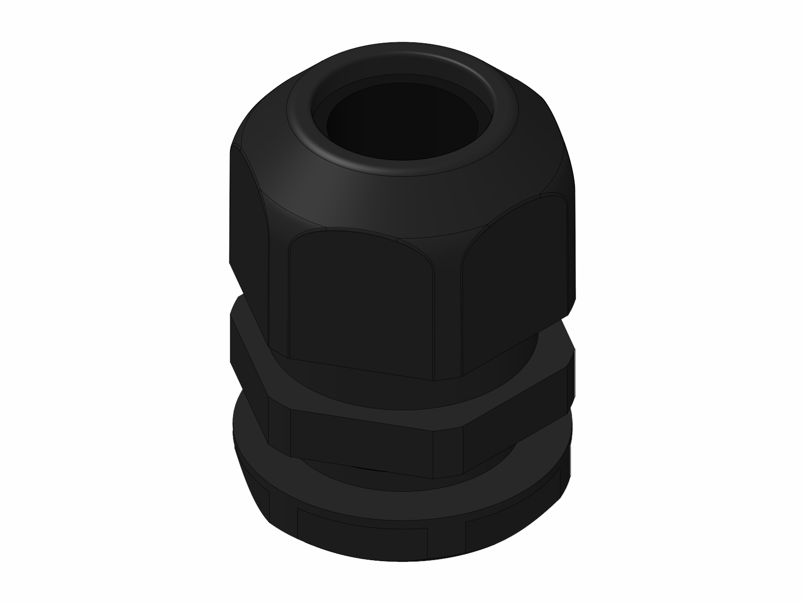
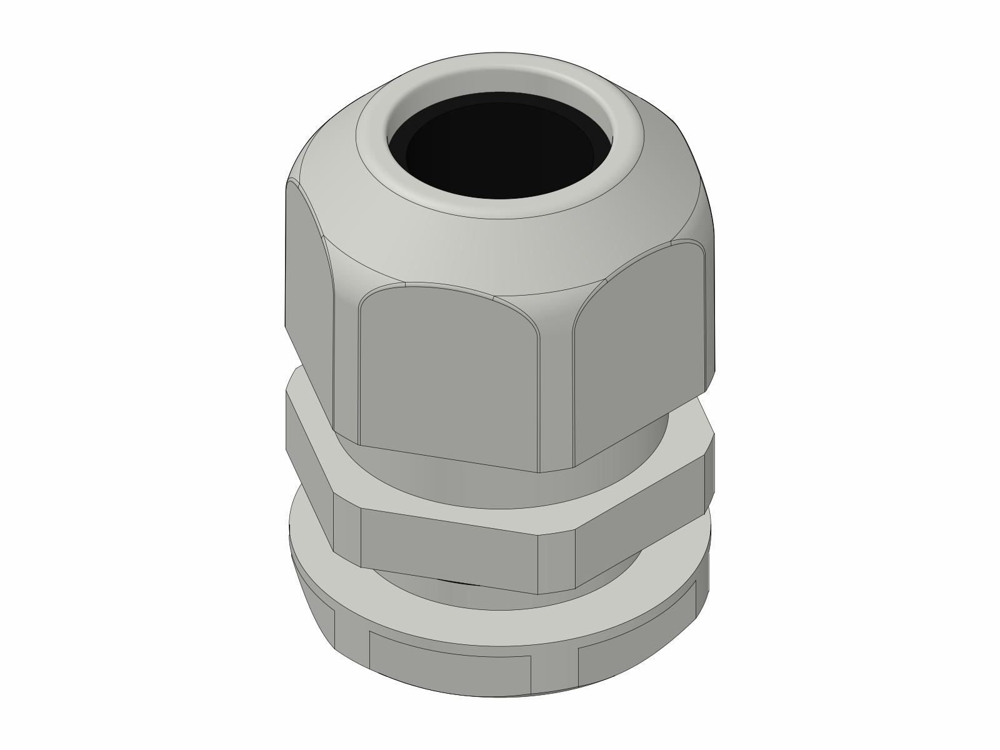

## RM25L-17B

## RM25L-17S

## STEP files

| Model | Color | File |
|---|---|---|
| RM25L-17B | Black | [RM25L-17B.step](RM25L-17B.step) |
| RM25L-17S | Light gray | [RM25L-17S.step](RM25L-17S.step) |

## Dimensions

| mm | L (Z) | D (Y) |
|---|---|---|
| Drawing | 50 | 36.8 |
| Overall (all parts) | 50 | 36.8 |

Mounting hole: ⌀25.2 mm

Notice: [NOTICE.md](../../../NOTICE.md) · License: [CC BY 4.0](../../../LICENSE)
