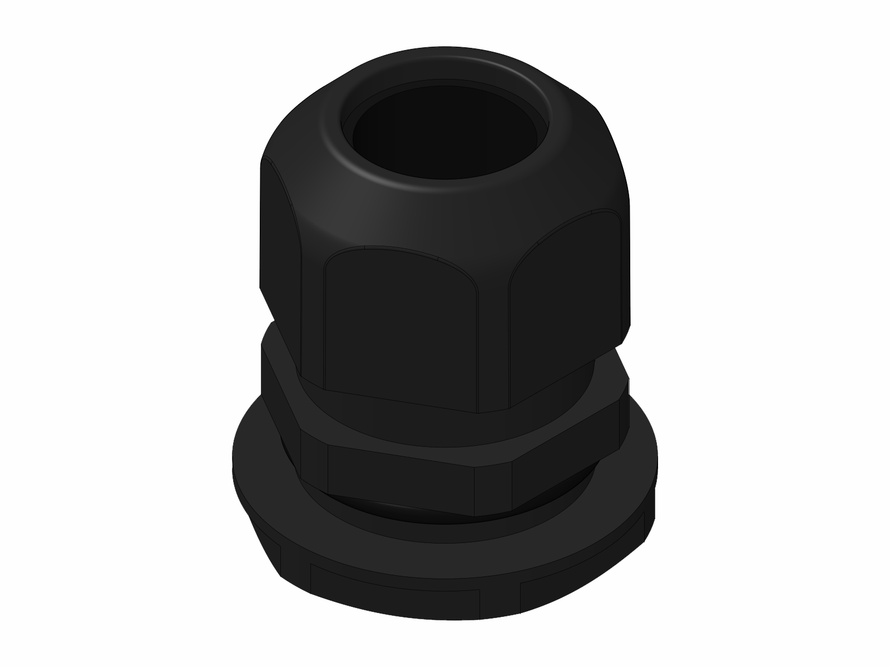
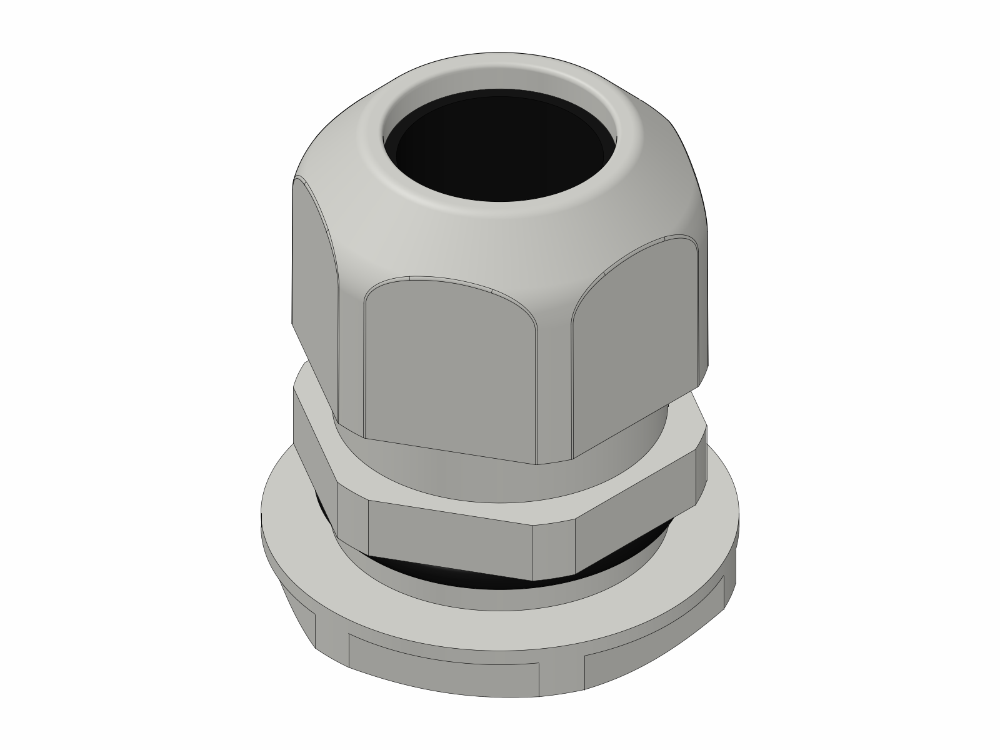

## RM32L-21B

## RM32L-21S

## STEP files

| Model | Color | File |
|---|---|---|
| RM32L-21B | Black | [RM32L-21B.step](RM32L-21B.step) |
| RM32L-21S | Light gray | [RM32L-21S.step](RM32L-21S.step) |

## Dimensions

| mm | L (Z) | D (X) |
|---|---|---|
| Drawing | 53 | 45 |
| Overall (all parts) | 53 | 45 |

Mounting hole: ⌀32.3 mm

Notice: [NOTICE.md](../../../NOTICE.md) · License: [CC BY 4.0](../../../LICENSE)
