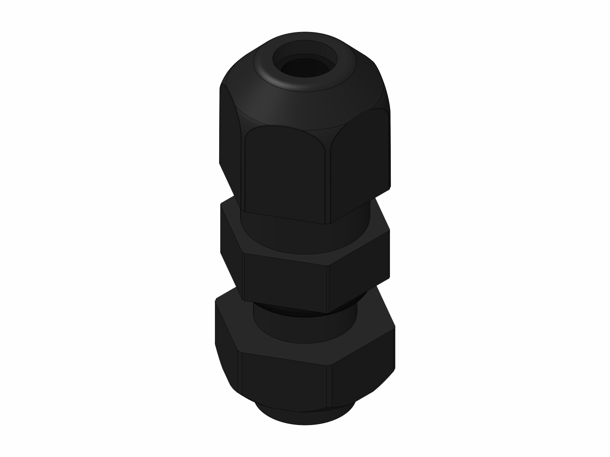
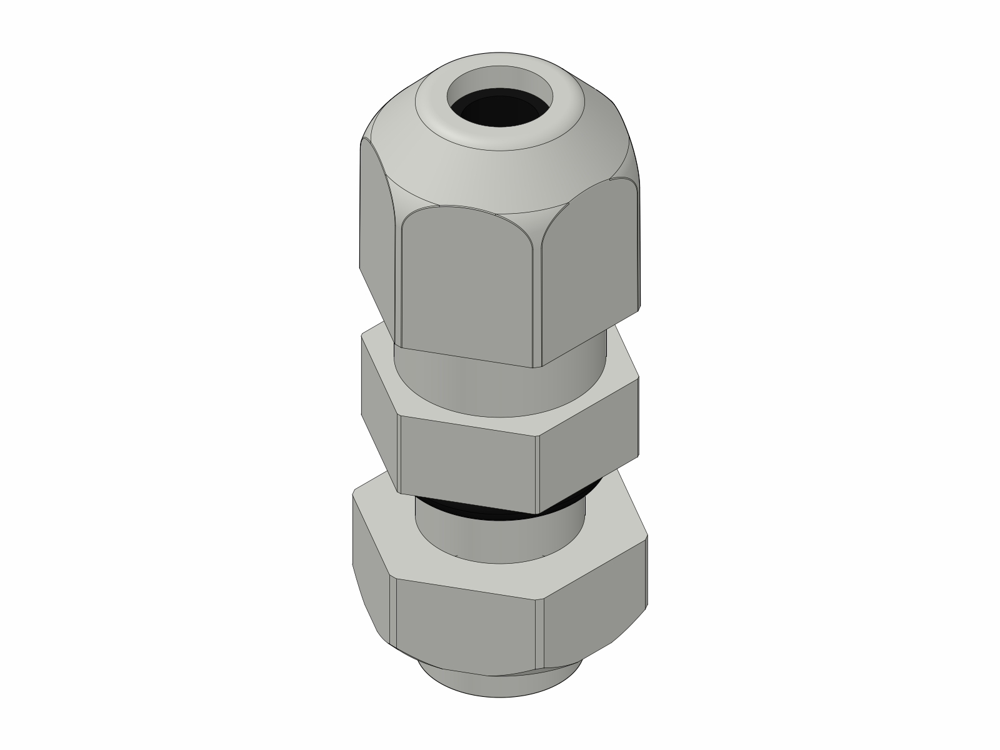

## RM8L-4B

## RM8L-4S

## STEP files

| Model | Color | File |
|---|---|---|
| RM8L-4B | Black | [RM8L-4B.step](RM8L-4B.step) |
| RM8L-4S | Light gray | [RM8L-4S.step](RM8L-4S.step) |

## Dimensions

| mm | L (Z) | D (Y) |
|---|---|---|
| Drawing | 32.5 | 14.3 |
| Overall (all parts) | 32.5 | 14.3 |

Mounting hole: ⌀8.2 mm

Notice: [NOTICE.md](../../../NOTICE.md) · License: [CC BY 4.0](../../../LICENSE)
