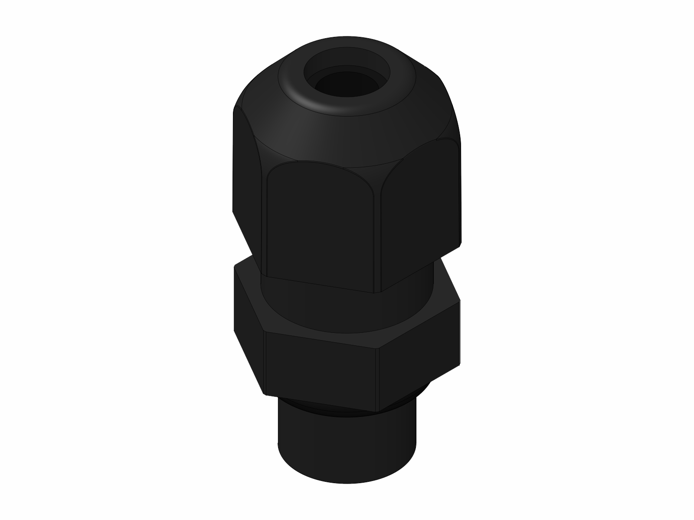
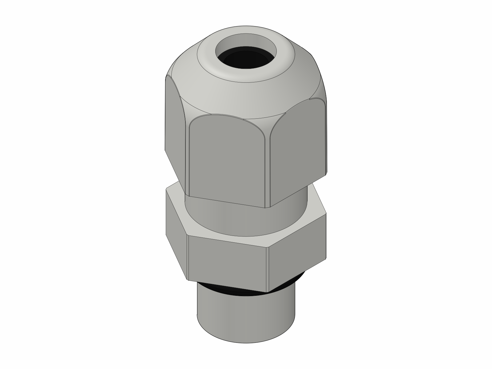

## RM8S-4B

## RM8S-4S

## STEP files

| Model | Color | File |
|---|---|---|
| RM8S-4B | Black | [RM8S-4B.step](RM8S-4B.step) |
| RM8S-4S | Light gray | [RM8S-4S.step](RM8S-4S.step) |

## Dimensions

| mm | L (Z) | D (Y) |
|---|---|---|
| Drawing | 27 | 13.6 |
| Overall (all parts) | 27 | 13.6 |

Mounting hole: M8×1.25 tapped

Notice: [NOTICE.md](../../../NOTICE.md) · License: [CC BY 4.0](../../../LICENSE)
