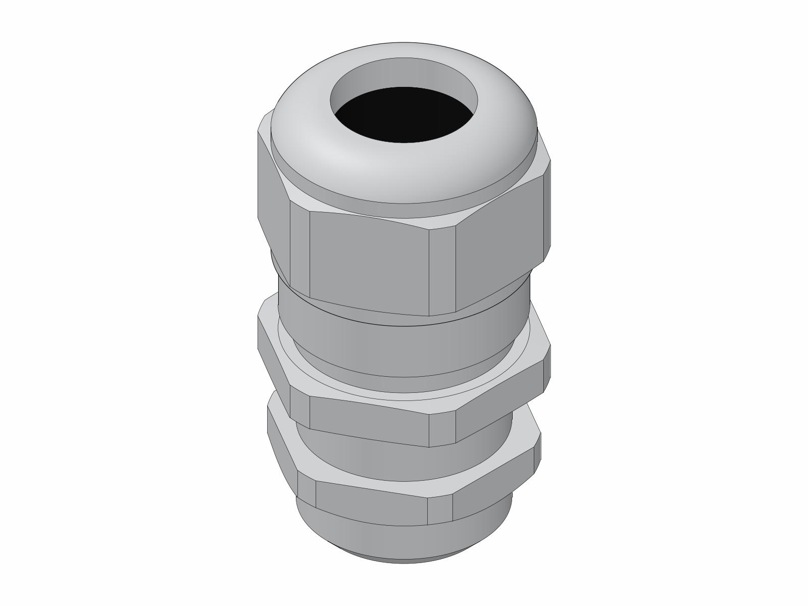

## RMC12-7.5

## STEP files

| Model | Color | File |
|---|---|---|
| RMC12-7.5 | Nickel plated | [RMC12-7.5.step](RMC12-7.5.step) |

## Dimensions

| mm | L (Z) | D (Y) |
|---|---|---|
| Drawing | 28 | 16.5 |
| Overall (all parts) | 28 | 16.5 |

Mounting hole: ⌀12.2 mm

Notice: [NOTICE.md](../../../NOTICE.md) · License: [CC BY 4.0](../../../LICENSE)
