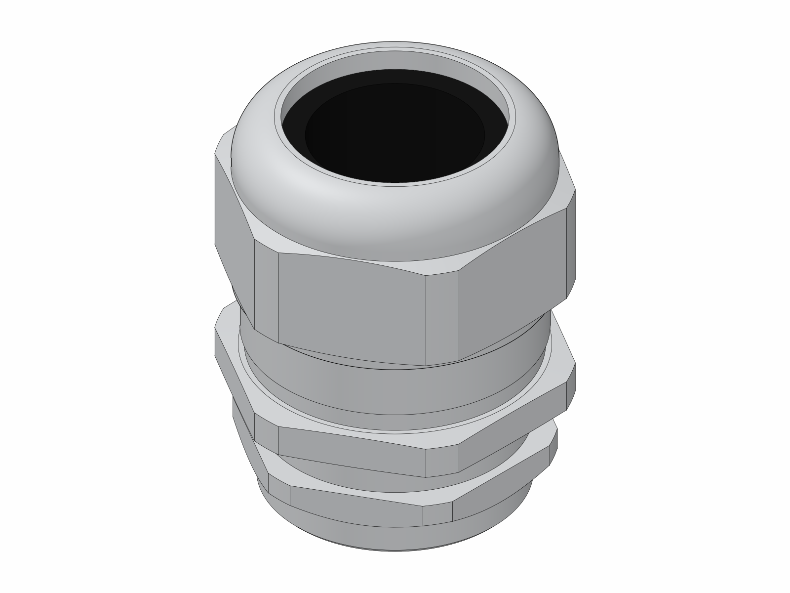

## RMC25-16

## STEP files

| Model | Color | File |
|---|---|---|
| RMC25-16 | Nickel plated | [RMC25-16.step](RMC25-16.step) |

## Dimensions

| mm | L (Z) | D (Y) |
|---|---|---|
| Drawing | 39.5 | 33 |
| Overall (all parts) | 39.5 | 33 |

Mounting hole: ⌀25.2 mm

Notice: [NOTICE.md](../../../NOTICE.md) · License: [CC BY 4.0](../../../LICENSE)
