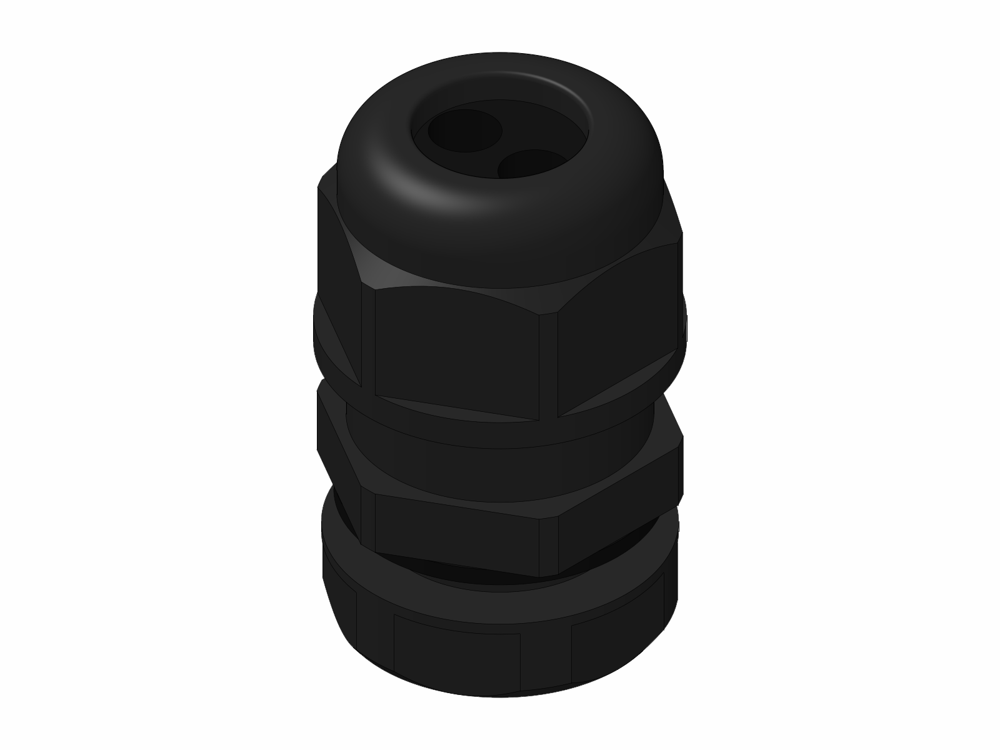
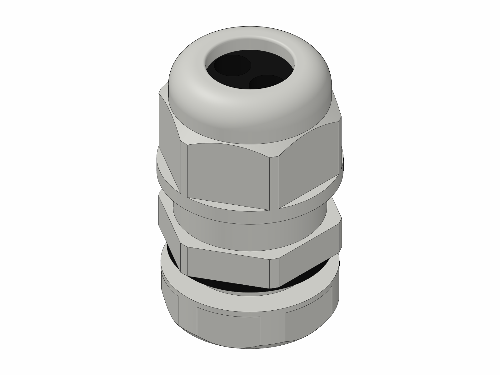

## RMH20-2B

## RMH20-2S

## STEP files

| Model | Color | File |
|---|---|---|
| RMH20-2B | Black (approx. RAL 9005) | [RMH20-2B.step](RMH20-2B.step) |
| RMH20-2S | Light gray (approx. RAL 7035) | [RMH20-2S.step](RMH20-2S.step) |

## Dimensions

| mm | L (Z) | D (Y) |
|---|---|---|
| Drawing | 49.5 | 30.4 |
| Overall (all parts) | 49.5 | 30.4 |

Mounting hole: ⌀20.2 mm

Notice: [NOTICE.md](../../../NOTICE.md) · License: [CC BY 4.0](../../../LICENSE)
