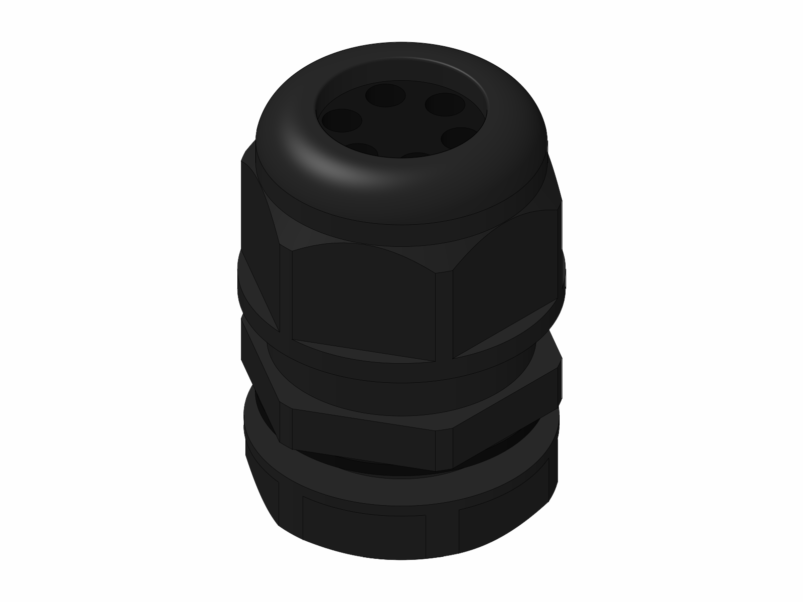
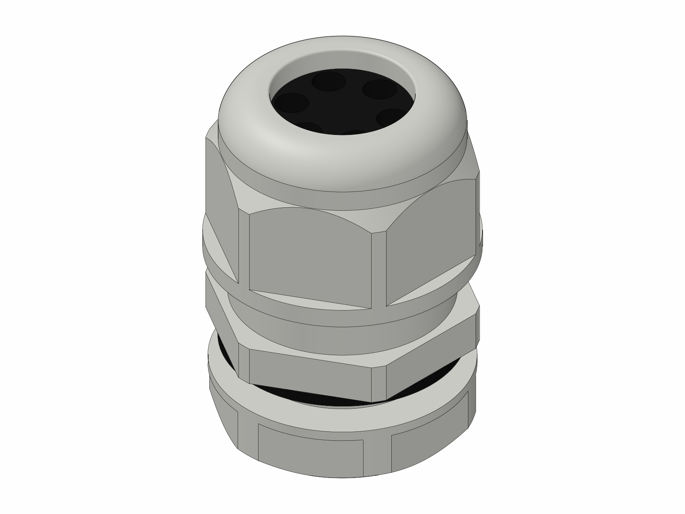

## RMH25-6B

## RMH25-6S

## STEP files

| Model | Color | File |
|---|---|---|
| RMH25-6B | Black (approx. RAL 9005) | [RMH25-6B.step](RMH25-6B.step) |
| RMH25-6S | Light gray (approx. RAL 7035) | [RMH25-6S.step](RMH25-6S.step) |

## Dimensions

| mm | L (Z) | D (Y) |
|---|---|---|
| Drawing | 52.5 | 37 |
| Overall (all parts) | 52.5 | 37 |

Mounting hole: ⌀25.2 mm

Notice: [NOTICE.md](../../../NOTICE.md) · License: [CC BY 4.0](../../../LICENSE)
