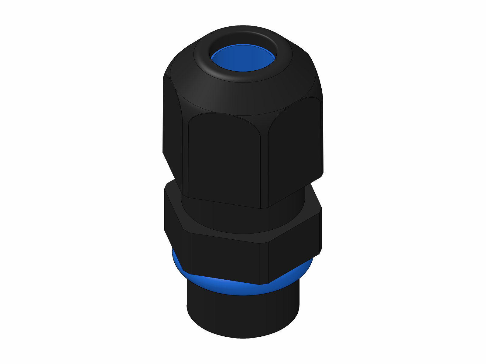
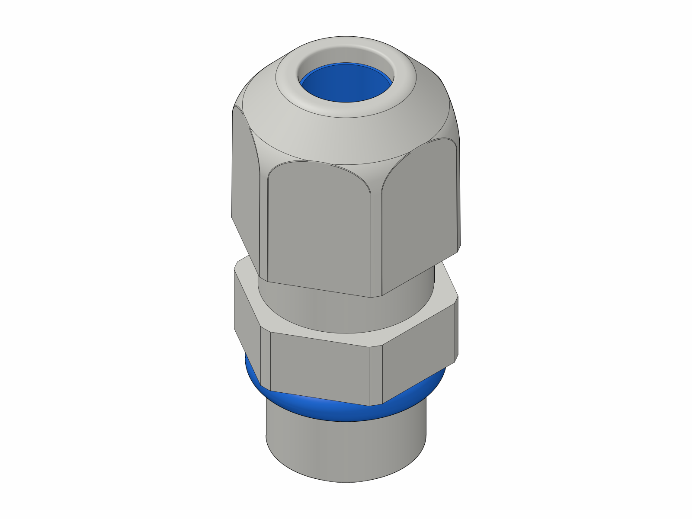

## RMW10S-6B

## RMW10S-6S

## STEP files

| Model | Color | File |
|---|---|---|
| RMW10S-6B | Black | [RMW10S-6B.step](RMW10S-6B.step) |
| RMW10S-6S | Light gray | [RMW10S-6S.step](RMW10S-6S.step) |

## Dimensions

| mm | L (Z) | D (Y) |
|---|---|---|
| Drawing | 28.5 | 14.6 |
| Overall (all parts) | 28.5 | 14.6 |

Mounting hole: M10×1.5 tapped

Notice: [NOTICE.md](../../../NOTICE.md) · License: [CC BY 4.0](../../../LICENSE)
