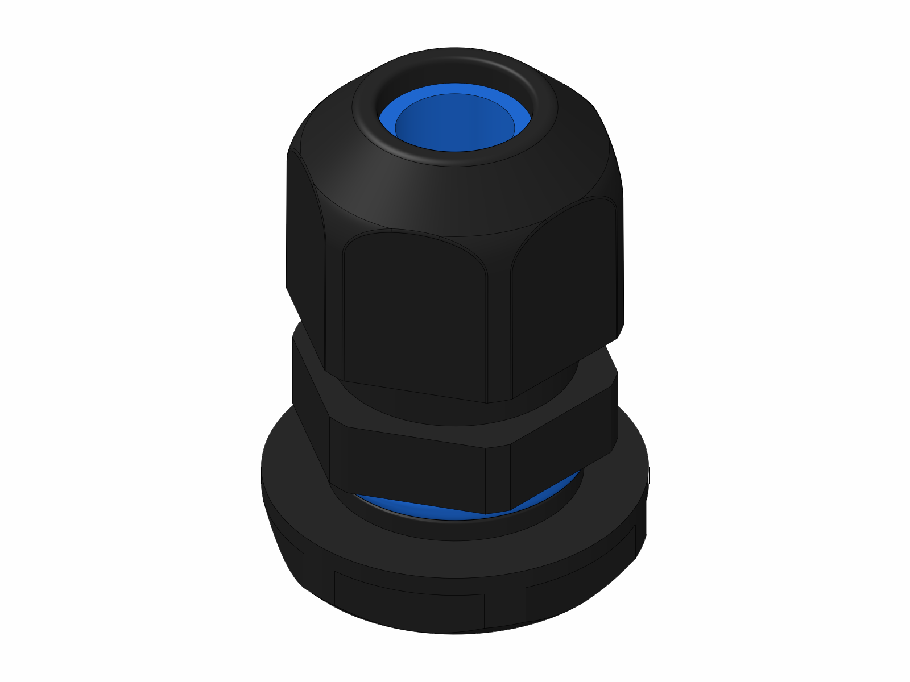
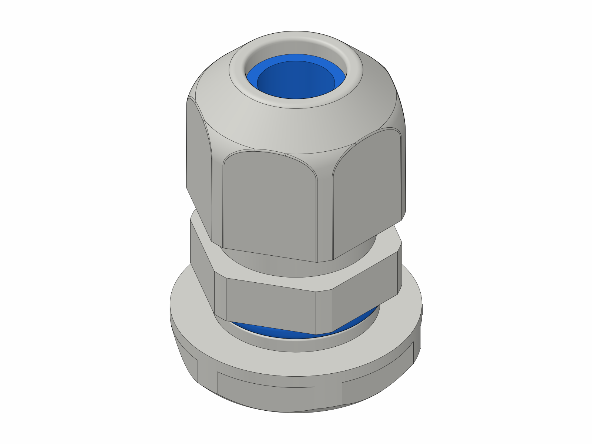

## RMW16S-8B

## RMW16S-8S

## STEP files

| Model | Color | File |
|---|---|---|
| RMW16S-8B | Black | [RMW16S-8B.step](RMW16S-8B.step) |
| RMW16S-8S | Light gray | [RMW16S-8S.step](RMW16S-8S.step) |

## Dimensions

| mm | L (Z) | D (X) |
|---|---|---|
| Drawing | 33 | 24 |
| Overall (all parts) | 33 | 24 |

Mounting hole: ⌀16.2 mm

Notice: [NOTICE.md](../../../NOTICE.md) · License: [CC BY 4.0](../../../LICENSE)
