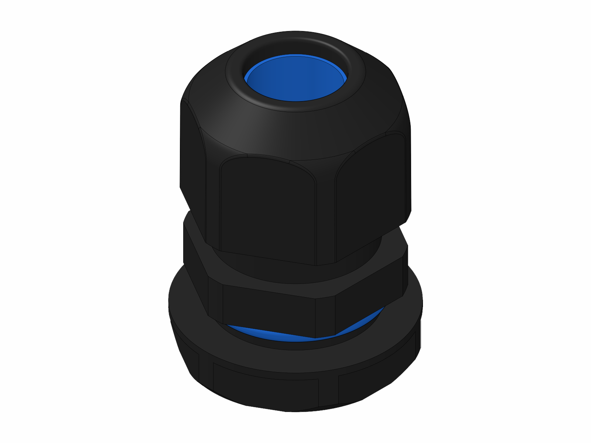
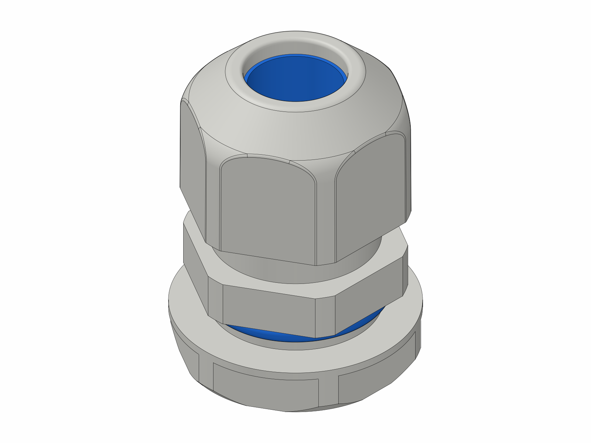

## RMW20S-12B

## RMW20S-12S

## STEP files

| Model | Color | File |
|---|---|---|
| RMW20S-12B | Black | [RMW20S-12B.step](RMW20S-12B.step) |
| RMW20S-12S | Light gray | [RMW20S-12S.step](RMW20S-12S.step) |

## Dimensions

| mm | L (Z) | D (X) |
|---|---|---|
| Drawing | 38.5 | 29 |
| Overall (all parts) | 38.5 | 29 |

Mounting hole: ⌀20.2 mm

Notice: [NOTICE.md](../../../NOTICE.md) · License: [CC BY 4.0](../../../LICENSE)
