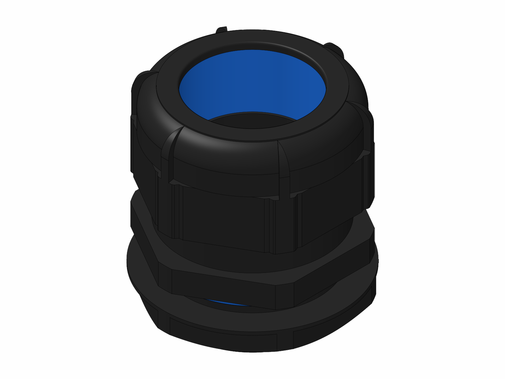
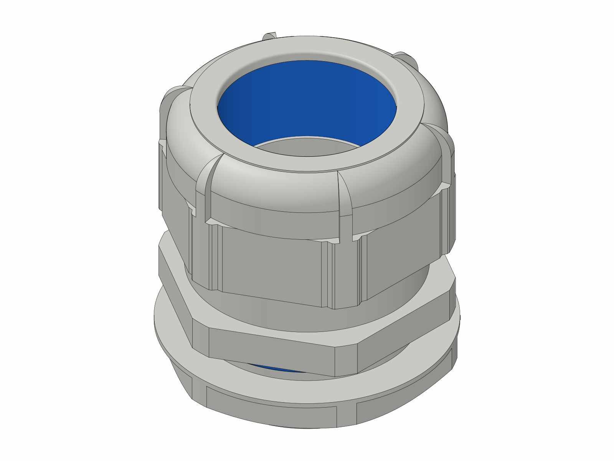

## RMW50L-38B

## RMW50L-38S

## STEP files

| Model | Color | File |
|---|---|---|
| RMW50L-38B | Black | [RMW50L-38B.step](RMW50L-38B.step) |
| RMW50L-38S | Light gray | [RMW50L-38S.step](RMW50L-38S.step) |

## Dimensions

| mm | L (Z) | D (X) |
|---|---|---|
| Drawing | 70.5 | 67.4 |
| Overall (all parts) | 70.5 | 67.4 |

Mounting hole: ⌀50.4 mm

Notice: [NOTICE.md](../../../NOTICE.md) · License: [CC BY 4.0](../../../LICENSE)
