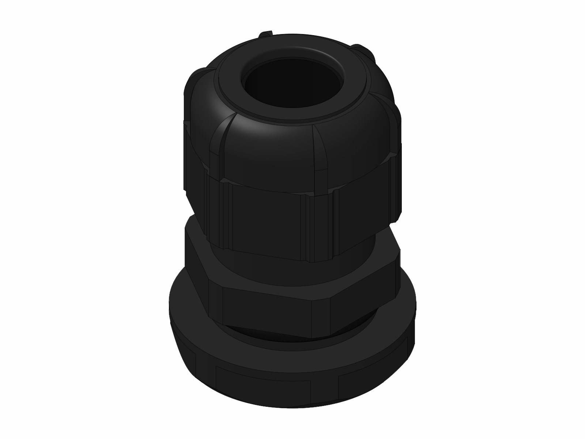
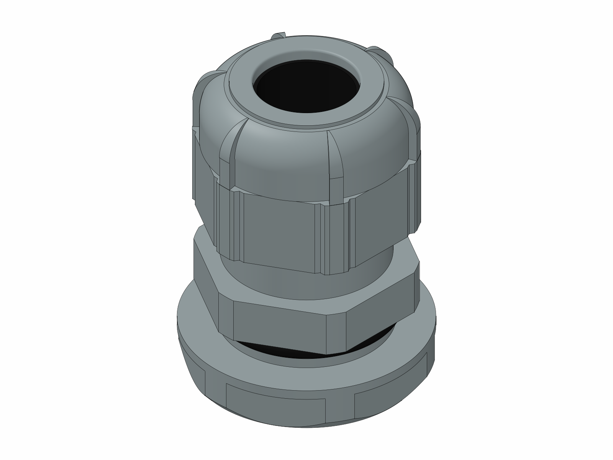

## RPG13.5-11B

## RPG13.5-11G

## STEP files

| Model | Color | File |
|---|---|---|
| RPG13.5-11B | Black (approx. RAL 9005) | [RPG13.5-11B.step](RPG13.5-11B.step) |
| RPG13.5-11G | Gray (approx. RAL 7001) | [RPG13.5-11G.step](RPG13.5-11G.step) |

## Dimensions

| mm | L (Z) | D (Y) |
|---|---|---|
| Drawing | 39 | 29.4 |
| Overall (all parts) | 39 | 29.4 |

Mounting hole: ⌀20.6 mm

Notice: [NOTICE.md](../../../NOTICE.md) · License: [CC BY 4.0](../../../LICENSE)
