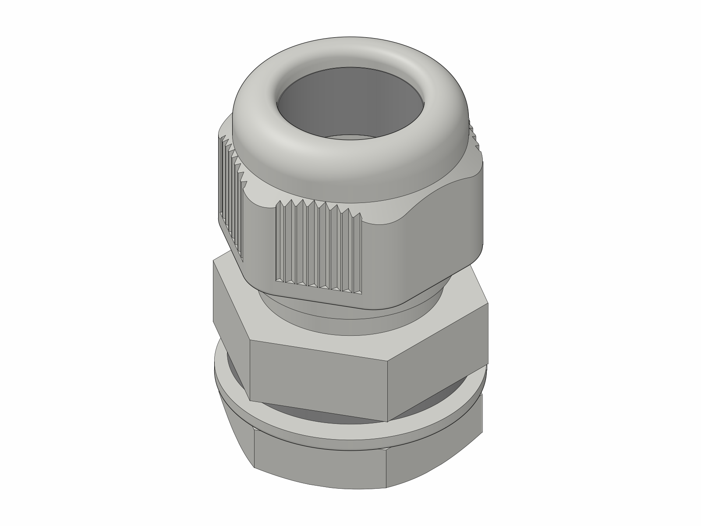
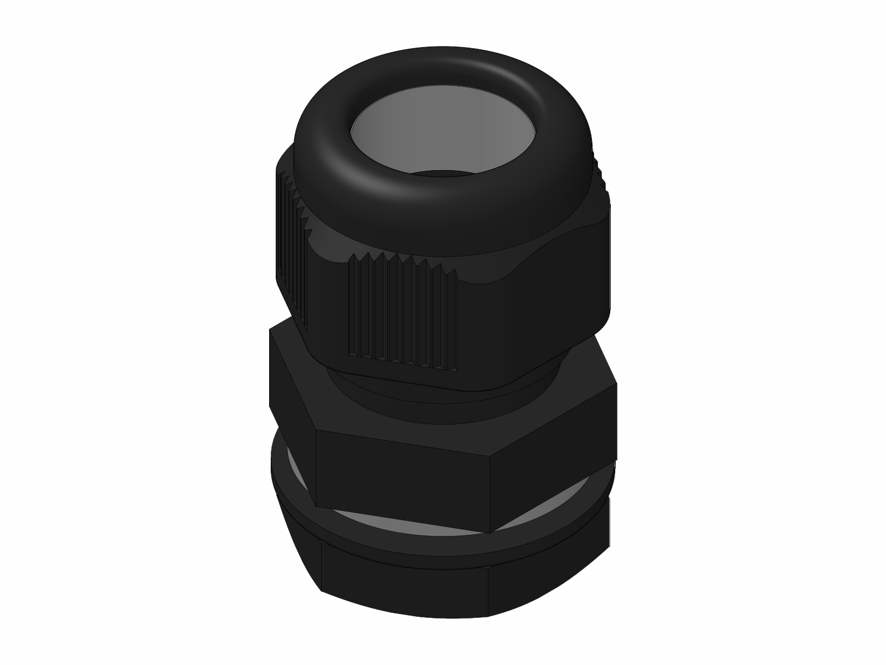
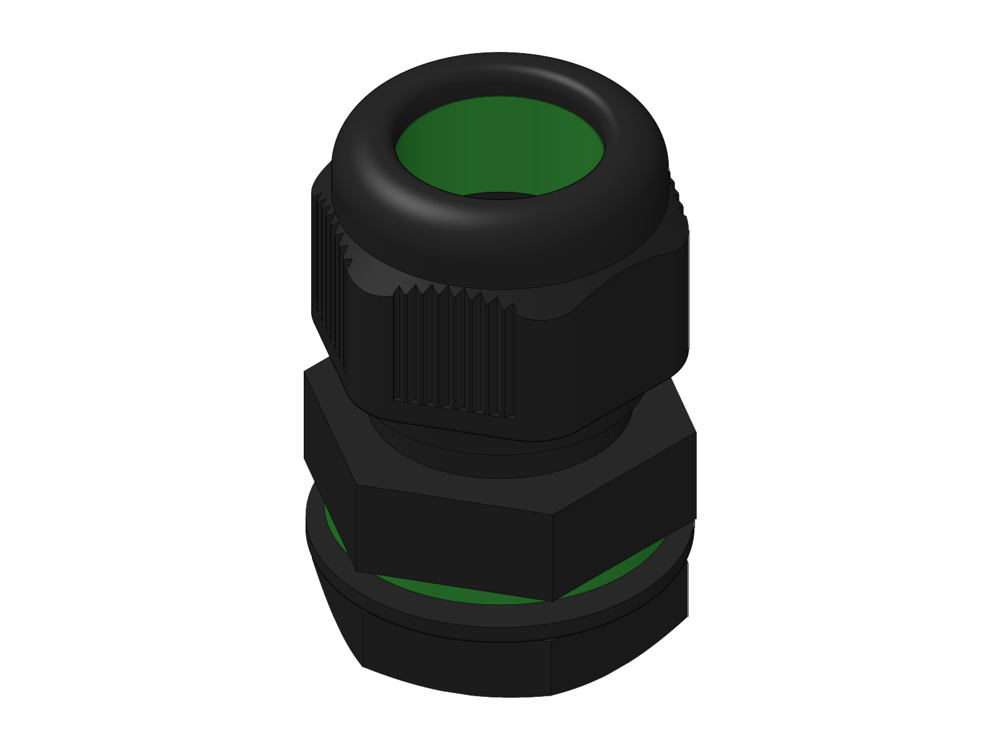

## THA451-20L

## THA451-20B

## THA451-20G

## STEP files

| Model | Color | File |
|---|---|---|
| THA451-20L | Light gray / Gray | [THA451-20L.step](THA451-20L.step) |
| THA451-20B | Black / Gray | [THA451-20B.step](THA451-20B.step) |
| THA451-20G | Black / Green | [THA451-20G.step](THA451-20G.step) |

## Dimensions

| mm | L (Z) | D (Y) |
|---|---|---|
| Drawing | 39 | 27.713 |
| Overall (all parts) | 39 | 27.712 |

Mounting hole: ⌀20.2 mm

Notice: [NOTICE.md](../../../NOTICE.md) · License: [CC BY 4.0](../../../LICENSE)
